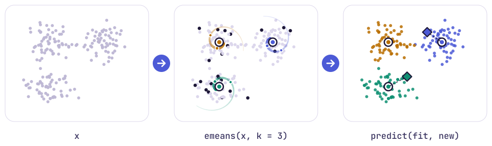

# emeans <picture><source media="(prefers-color-scheme: dark)" srcset="man/figures/emeans-logo-dark-animated.svg"></picture>

<picture><source media="(prefers-color-scheme: dark)" srcset="man/figures/hero-dark.svg"></picture>

emeans brings **e-means** to R, a mini-batch alternative to k-means from
Meta FAIR whose authors report a lower loss than Lloyd’s algorithm in
about a tenth of the epochs, with no extra hyperparameters to fret over
(Bessa et al., 2026). Each centroid follows an exponential moving
average of the batches it sees, and the package does the arithmetic in
C++ on the CPU or, if you have one handy, on a GPU through
[torch](https://torch.mlverse.org/). The GPU path has been tested on
Apple MPS and on torch’s CPU device, while `device = "cuda"` has yet to
meet an NVIDIA card and should be treated as experimental.

## Installation

Install the released version from CRAN:

``` r
install.packages("emeans")
```

or the development version from GitHub:

``` r
# install.packages("pak")
pak::pak("coatless-rpkg/emeans")
```

[Quarto](https://quarto.org/) renders the vignettes, so you need it only
if you plan to build them yourself.

## Quick start

``` r
library(emeans)

set.seed(2026)
x <- rbind(
  matrix(rnorm(20000, mean = 0), ncol = 2),
  matrix(rnorm(20000, mean = 4), ncol = 2),
  matrix(rnorm(20000, mean = c(0, 4)), ncol = 2, byrow = TRUE)
)

fit <- emeans(x, 3, nepochs = 5, threads = 2)
fit
```

    #> e-means clustering: k = 3, 30000 rows
    #>   epochs 5, batch 128, alpha0 0.32
    #>   tot.withinss 57255.2 (between_SS / total_SS = 79.0 %), n_splits 0
    #>   device cpu

``` r
km <- kmeans(x, 3, nstart = 1)
```

`emeans(x, k)` slots into code written for `stats::kmeans(x, k)`, since
the result carries the same `cluster`, `centers`, `size`, `withinss`,
`tot.withinss`, `totss` and `betweenss` and answers to `predict()`; the
one difference worth knowing is that `iter` counts batch updates rather
than Lloyd iterations. Dividing `tot.withinss` by the number of rows
gives each fit’s mean squared distance from a point to its nearest
center:

``` r
c(emeans = fit$tot.withinss, kmeans = km$tot.withinss) / nrow(x)
```

    #>   emeans   kmeans 
    #> 1.908506 1.908503

On a problem this easy the two finish in a dead heat, so
`vignette("emeans")` sets them a harder one. Once trained, the fit
labels new points by their nearest center through `predict()`:

``` r
predict(fit, rbind(c(0, 0), c(4, 4)))
```

    #> [1] 3 1

When the data will not fit in memory, the experimental `em_begin()`,
`em_accumulate()`, `em_update()`, `em_end_epoch()` and `em_finalize()`
let you feed training one batch at a time from wherever the rows happen
to live, as `vignette("large-data", package = "emeans")` walks through.

## Credit

The algorithm comes from the e-means paper by Bessa et al. (2026) at
Meta FAIR, and its reference Python implementation, written by Gergely
Szilvasy, Swann Bessa and Matthijs Douze, lives in faiss
`contrib/e_means` under the MIT licence and ships with FAISS 1.16.0.
emeans ports that code to R and C++ from upstream commit
[`2b648f0`](https://github.com/facebookresearch/faiss/tree/2b648f0605f2ef3d14c4705350f8a0b214463878/contrib/e_means),
and we checked it against the Python original pass by pass, feeding both
the same data, starting centers, batch orders and random draws. R’s
random number generator stands in for numpy’s, so the same seed will not
reproduce a Python run; `?emeans` lists this and the other deliberate
differences.

emeans is an independent port written without the involvement of the
e-means or faiss authors, so please send any trouble with it to the
[emeans issue tracker](https://github.com/coatless-rpkg/emeans/issues)
rather than to them.

Upstream resources:

- Paper: [arXiv:2611.09501](https://arxiv.org/abs/2611.09501)
- Python implementation: [faiss
  `contrib/e_means`](https://github.com/facebookresearch/faiss/tree/main/contrib/e_means),
  released in [FAISS
  1.16.0](https://github.com/facebookresearch/faiss/releases/tag/v1.16.0)
- Blog: <https://e-means.github.io>
- Announcement: [Swann Bessa on
  X](https://x.com/swann_bessa/status/2120200714630594911)

## Citing e-means

If e-means earns a place in your work, please cite the paper below;
`citation("emeans")` gives it alongside an entry for the faiss
implementation that this package ports.

``` bibtex
@misc{bessa2026emeans,
  title  = {{e-means}: outperforming {k-means} (in one-tenth the epochs)},
  author = {Bessa, Swann and Mazar{\'e}, Pierre-Emmanuel and Szilvasy, Gergely and
            Touvron, Hugo and Picard, David and Douze, Matthijs and J{\'e}gou, Herv{\'e}},
  year   = {2026},
  note   = {Preprint},
  url    = {https://arxiv.org/abs/2611.09501}
}
```
